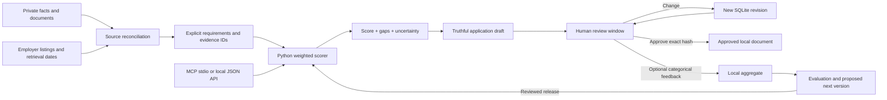

# Architecture and execution map

## Where each step happens

1. An external research agent reads documents and original job listings. Reading is not training. Source reconciliation and writing currently happen in the agent conversation, not in a background service.
2. A private JSON workspace stores evidence, explicit assessor judgments and initial documents. The public repository supplies synthetic fixtures only.
3. `engine.match` validates referenced evidence and computes a deterministic result. The evidence retrieval operation is an ID lookup. There is no vector database or automatic semantic assessment in v0.1.
4. `server.py` binds to loopback, checks Host and write token/origin, limits request size, and serves only allowlisted web assets. It does not serve the repository or private directory as files.
5. `store.py` uses SQLite transactions for revision checks. SHA-256 identifies content; it is not encryption or a digital signature. Each edit creates a draft. Approval refers to the current revision/hash. Pending change requests block approval.
6. Browser UI uses safe DOM text insertion for all profile/job/document content. Job links accept HTTP(S) only. The 3D scheme uses CSS perspective, rotation and depth transforms; it is an explanatory visual, not a physical simulation.
7. Feedback accepts three categories and binary values. Private instructions remain in the private request table. Aggregate output requires at least 10 records per category. This threshold alone does not guarantee anonymity or differential privacy.

## The mathematics

`x = [1, .5, 0]`, `w = [3, 2, 1]`, `b = 0` gives `100(3 + 1 + 0)/6 = 66.7`.
Weights are chosen judgments, not learned parameters. A single feature version is `y = wx + b`; multiple requirements use `y = wᵀx + b`, with normalisation for a 0–100 display. Human experience is not a physical force and a linear score is not a causal law.

Coverage counts the importance of assessed requirements, including known gaps. Unknown upper bound adds unknown weights to the numerator; partial evidence stays at 0.5. Eligibility rules are evaluated separately, so strong preferences cannot cancel a mandatory gap. `review_required` does not mean verified legal eligibility.

## Environments

| Environment | Data | Exposure | Payments |
|---|---|---|---|
| Local demo | Synthetic | Loopback | None |
| Private review | User-owned facts/documents | Loopback, local OS permissions | None |
| Payment sandbox | Synthetic request only | Separate adapter | Test funds / Stripe test mode |
| Future hosted service | Tenant-isolated, consented | TLS, authenticated API | Verified metering and entitlements |

Future deployment needs authentication, authorisation per tenant, encrypted storage and backups, rate limits, deletion/retention operations, queue workers, audited payment reconciliation, monitoring and incident response. The standard-library development server is not a production SaaS server. No Kubernetes, cloud infrastructure or model training job is secretly provisioned.

## Scaling plan

Separate retrieval, inference and export workers. Put versioned evidence schemas behind a tenant-scoped API. Use PostgreSQL for transaction records and object storage for encrypted artifacts; keep evaluation data separately consented. Add job-source adapters with terms-aware refresh and expiry, idempotent queues, bounded retries, dead-letter recovery and circuit breakers. Measure p50/p95 latency, cost per accepted draft, provenance completeness and failed jobs before selecting infrastructure. Model/provider versions and feature versions must be pinned per result. Permit human overrides and appeals; do not automate rejection of jobseekers.

The canonical guide for future agents is `AGENTS.md`; the provenance/ownership index is `docs/INVENTION_RECORD.md`.
